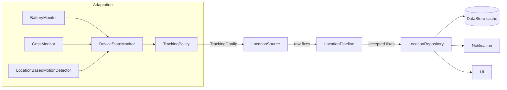

#  GPS Tracker

An Android app (Kotlin, Jetpack Compose) that keeps an accurate live location in the background, adapts its power use to the device's condition, and works with or without Google Play Services. The UI is text-only by design.

## 1. Requirements and how they are met

| Requirement | How it is met |
|---|---|
| Works in the background | Location-type foreground service |
| Works with low battery | `TrackingPolicy` reduces accuracy and frequency at 20% and 10%, and with Power Saver on |
| Works with weak signal | `GnssMonitor` detects weak GNSS; `WEAK_GNSS` mode uses network location with short GPS retries |
| Does not compromise phone performance | No wake locks, batching, `STATIONARY` mode, throttled writes and notifications |
| Caches the last known location | DataStore; the cached fix is shown immediately, labelled CACHED |
| Fresh location replaces the cache | Accepted fixes replace it and are labelled LIVE; they go stale by age |
| Keeps asking for permission | `PermissionFlow` is re-evaluated on every resume and blocks the tracker until location is granted |
| Uses all providers | Fused where available; otherwise platform fused, or GPS + network merged by `BestFixSelector` |
| Accuracy near high-rise buildings | `AccuracyGate` → `JumpDetector` → `KalmanFilter` |
| Devices without Play Services | Separate location source, selected at runtime |

## 2. Architecture



Layers: `domain` (models, filters, policy), `data` (sources, cache, repository), `device` (monitors), `service`, `background` (recovery), `permission`, `ui`.

## 3. Key decisions

**Foreground service.** It is the only supported way to receive frequent fixes in the background. Alternatives deliver a few fixes per hour at best.

**Fused first, platform otherwise.** The fused provider gives better accuracy per unit of battery because it blends sources and shares fixes between apps. It needs Play Services, so `LocationSourceFactory` checks once and falls back.

**One process.** The service and UI share `LocationRepository` directly, so the screen updates on every accepted fix. A separate tracker process would isolate the service from UI memory and crashes, but it adds cross-process state for little gain in an app this small.

**Motion from location only.** `LocationBasedMotionDetector` needs no extra permission and behaves the same on every device. Activity Recognition would notice movement sooner, but it needs Play Services and a separate solution for other devices.

**Three-stage accuracy pipeline.** Each stage catches what the others cannot:
- `AccuracyGate` drops fixes that report poor accuracy (> 50 m, or > 30 m for GPS with under 4 satellites). After 60 s with nothing accepted, the best recent fix passes, flagged low confidence.
- `JumpDetector` drops locations that report good accuracy but imply an impossible speed, usually caused by signals bouncing off buildings. Three rejected fixes that agree are believed, so it cannot get stuck.
- `KalmanFilter` smooths the remaining jitter, weighting by reported accuracy. Process noise follows motion, so a still user is smoothed hard and a fast one does not lag.

**Adaptive policy.** Evaluated in this order by a pure function:

| Mode | Trigger | Priority | Interval / distance | Max batch |
|---|---|---|---|---|
| `CRITICAL` | Battery ≤ 10%, not charging | LOW_POWER | 60 s / 50 m | 5 min |
| `SAVER` | Battery ≤ 20%, not charging, or Power Saver | BALANCED | 30 s / 20 m | 2 min |
| `STATIONARY` | Still for ≥ 2 min | LOW_POWER | 1 min / 0 m | none |
| `WEAK_GNSS` | Weak signal for 30 s | BALANCED, HIGH_ACCURACY for 30 s every 2 min | 15 s / 10 m | none |
| `ACTIVE` | Otherwise | HIGH_ACCURACY | 5 s / 5 m | none |

Device state changes wait 5 s because restarting a location request has a cost. The first state and the moment the user starts moving apply at once.

## 4. Alternatives considered

| Alternative | Why it was rejected |
|---|---|
| PendingIntent updates only | Android limits background delivery to a few fixes per hour |
| WorkManager only | 15-minute minimum interval and deferred by Doze. Kept as a watchdog |
| AlarmManager | Needs exact-alarm permission, wakes the device repeatedly, and is not a location API |
| Geofencing | Only reports boundary crossings, not a live position; slow to trigger |

## 5. Devices without Google Play Services

| Capability | With GMS | Without GMS |
|---|---|---|
| Location | `FusedLocationProviderClient` | Platform fused (API 31+), else GPS + network with `BestFixSelector` |
| Motion | Location-based | Location-based |
| Turning on location | In-app resolution dialog | System location settings |
| Sticky restart, boot, watchdog | Yes | Yes |

## 6. Performance safeguards

- No wake locks: the system wakes the CPU to deliver fixes. No `Thread.sleep`.
- Batching in the low-battery modes, so the CPU sleeps between deliveries.
- `STATIONARY` mode when the user is still.
- GNSS callback registered only during high-accuracy requests. In weak signal, GPS is retried rather than left on.
- Location writes throttled to at most every 15 s unless moved > 20 m.
- Notification updates at most every 30 s.
- The one-second UI clock runs only while the screen is visible.
- Debug builds run StrictMode. `AppLog` logs nothing in release builds.

## 7. Background reliability

| Layer | Mechanism |
|---|---|
| Make a kill unlikely | Foreground service and battery exemption request |
| System restart | `START_STICKY`, restoring from the persisted flag |
| Reboot or app update | `BootReceiver` |
| Watchdog | `WatchdogWorker` every 15 min; "Tap to resume" notification if a start is refused |

Recovery after a kill that `START_STICKY` does not cover relies on the watchdog, so it can take about 15 minutes, or longer under Doze.

## 8. Build and run

Requires Android Studio with JDK 17 or newer and Android SDK 37.

```shell
./gradlew assembleDebug
./gradlew lint
./gradlew installDebug
```

Open the app, grant location access, and tap **Start tracking**. The minimum supported version is Android 8.0 (API 26).
